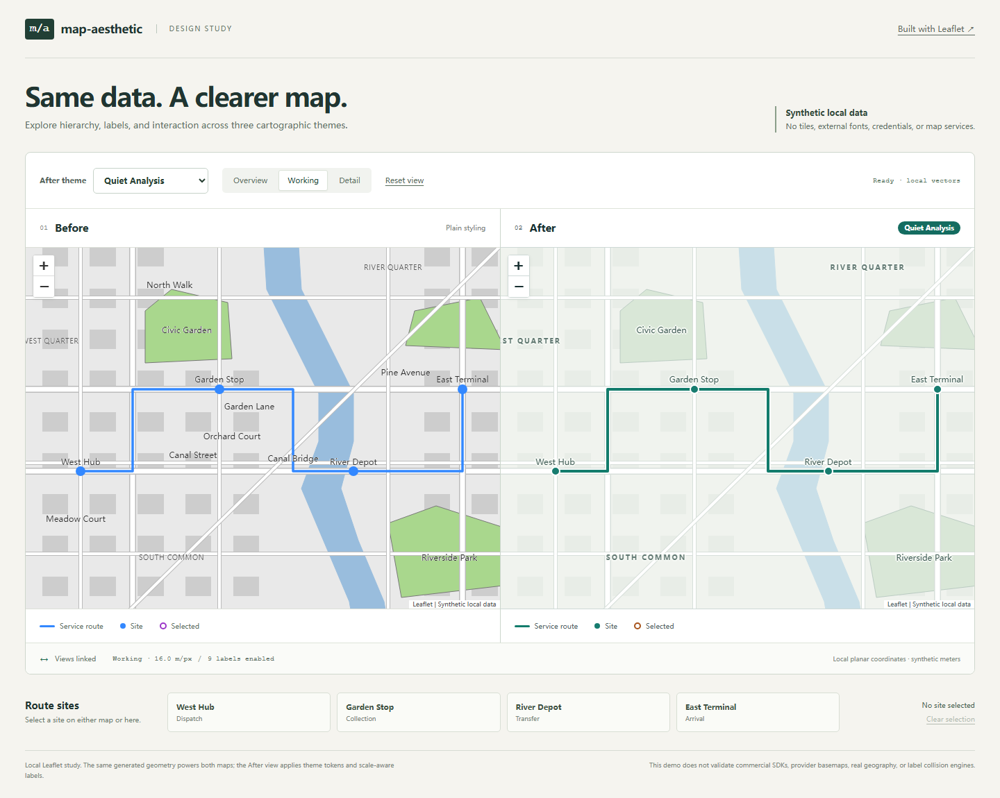

# Map Aesthetic

[简体中文](README.zh-CN.md) · [Project design / 项目设计](docs/project-design.zh-CN.md)

An agent skill for improving the cartography and interface of existing web maps.
It coordinates basemaps, business layers, labels, legends, controls, and popups
through a shared design process and SDK-specific guidance.

**Status: 0.1.0 initial project.** Five SDK families have documentation adapters.
The runnable demonstration uses Leaflet with local synthetic vector data.
Commercial-provider integration and production performance are not yet validated.



[Night theme and selection](docs/images/demo-night.png) · [Mobile layout](docs/images/demo-mobile.png)

## What it does

- Audits hierarchy, label density, symbol design, map/UI composition, and states.
- Produces design tokens and concrete changes in the existing application's SDK.
- Preserves data semantics, coordinates, feature identity, interactions, and attribution.
- Adapts to native capabilities instead of treating every provider's style JSON as interchangeable.
- Verifies representative scales, selection, popups, theme changes, and narrow screens.
- Separates observed results, inferred causes, and checks that could not be run.

The repository distributes an instruction-based skill, references, optional
theme validation, and a demonstration. It does not contain a universal map SDK
wrapper, an automatic style converter, or a production integration for every provider.

## Coverage

| SDK family | Included guidance | Runtime evidence in this repository |
| --- | --- | --- |
| [Leaflet](skills/map-aesthetic/references/adapters/leaflet.md) | Raster/vector boundary, symbols, panes, controls, lifecycle | Local synthetic demo; see [verification record](docs/verification.md) |
| [ArcGIS JS](skills/map-aesthetic/references/adapters/arcgis.md) | Layer types, renderers, labels, vector basemaps, UI | Documentation only |
| [Mapbox GL JS](skills/map-aesthetic/references/adapters/mapbox.md) | Classic styles, Standard configuration/slots, style reload | Documentation only |
| [AMap / 高德](skills/map-aesthetic/references/adapters/amap.md) | Published styles, feature visibility, overlays, controls | Documentation only |
| [Baidu / 百度](skills/map-aesthetic/references/adapters/baidu.md) | Version-aware styling, overlays, controls, compatibility | Documentation only |

Documentation adapters are decision guides, not executable adapter classes.
Each records dated official sources; implementation must check the actual SDK version.

## Install the skill

Clone the repository:

```sh
git clone https://github.com/yeston463/map-aesthetic.git
cd map-aesthetic
```

Copy **only** `skills/map-aesthetic` into your
agent's skill directory. For Codex's current user-scoped discovery, use
`~/.agents/skills/map-aesthetic`; repository-scoped installation uses
`<target-project>/.agents/skills/map-aesthetic`. See the
[official Codex skill locations](https://learn.chatgpt.com/docs/build-skills#where-codex-loads-local-skills).

On macOS / Linux, from this repository:

```sh
mkdir -p ~/.agents/skills
cp -R skills/map-aesthetic ~/.agents/skills/
```

On Windows PowerShell, from this repository:

```powershell
$mapSkillDestination = Join-Path $env:USERPROFILE '.agents\skills'
New-Item -ItemType Directory -Force -Path $mapSkillDestination | Out-Null
Copy-Item -LiteralPath '.\skills\map-aesthetic' -Destination $mapSkillDestination -Recurse
```

Inspect an existing installation before copying an update. Codex detects skill
changes automatically; restart if it does not appear. Other Agent Skills-capable
tools can load the same `SKILL.md`; host-specific discovery is not tested here.
`agents/openai.yaml` is optional Codex UI metadata. No npm package is needed to
read or use the skill. Python is needed only for the optional validator.

## Use it

```text
Use $map-aesthetic to refine this logistics map. Keep the current SDK,
provider, data meanings, and interactions. Reduce background noise,
emphasize routes and exceptional sites, unify the legend and popups,
then verify overview, working, and detail views on desktop and mobile.
```

Also supported: visual audits, reference-led refinement, day/night themes,
label hierarchy, and screenshot-only reviews. Screenshot-only work produces
a specification and implementation guidance; it cannot establish runtime success.

## Run the demo

Node 22.12+ and npm are required. Install packages once; the running demo uses
no map key, provider basemap, remote font, or external tile request.

```sh
npm ci
npm run dev
```

Open the local URL printed by Vite. Compare the same synthetic data before and
after refinement, change themes, select sites, and inspect scale behavior.
The fixture is a fictional local coordinate plane, not an authoritative map.

## Validate changes

Python 3.10+ is supported by the validation tools.

```sh
python -m pip install -r requirements-dev.txt
python scripts/check_project.py
python scripts/check_citations.py --offline
python -m unittest discover -s tests -v
npm run build
npx playwright install chromium
npm run test:browser
```

Theme files can be checked independently:

```sh
python skills/map-aesthetic/scripts/validate_theme.py path/to/theme.json
```

The validator checks structure, three UI text-contrast pairs, CIEDE2000 separability
between context surfaces and data classes, and token invariants. It refuses fills and
classes that cannot be told apart. It cannot prove SDK support, label readability,
overall aesthetic quality, or full color-vision accessibility, and a monotonic ramp is
not the same claim as one that reads as more-or-less.

Citations are checked separately. Provider documentation sites are single-page apps,
so a removed page can still answer HTTP 200; the check therefore pairs each adapter
citation with tokens that must appear on the page it opens.

```sh
python scripts/check_citations.py --offline   # claim table, no network
python scripts/check_citations.py             # resolve citations and confirm claims
```

Exit code 2 means the network blocked the conclusion, not that the citations hold.

## Project layout

```text
skills/map-aesthetic/   Installable skill, references, themes, report template, validator
demo/                  Credential-free Leaflet comparison using synthetic local vectors
docs/                  Detailed design, verification, release procedure, real demo images
evals/                 Behavioral scenarios, raw fixtures, and recorded evaluation results
tests/                 Theme-validator tests
tests-browser/         Browser checks for the demonstration
scripts/               Repository checks
.github/               CI and issue / pull-request templates
```

## Contribute and release

Start with [contributing](CONTRIBUTING.md), the [behavioral scenarios](evals/cases.md),
and the [release procedure](docs/releasing.md). Future coverage should grow through
real integration evidence, not provider-name lists. The detailed
[project design](docs/project-design.zh-CN.md) describes the roadmap and support levels.

MIT covers this project's original files. Dependencies retain their own licenses;
provider SDKs, map data, accounts, and service terms remain separate. See
[third-party notices](THIRD_PARTY.md). This project is independent of the named map providers.
