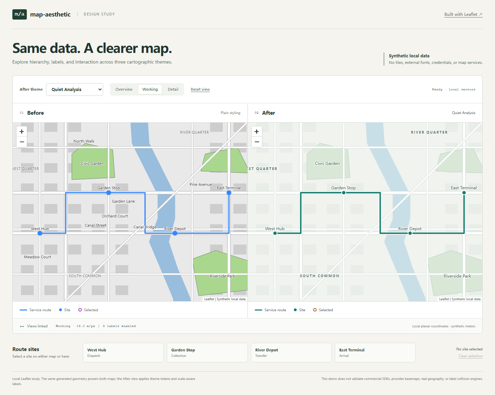

# Map Aesthetic

[English](README.md) · [详细项目设计](docs/project-design.zh-CN.md)

面向 AI 编程代理的 **Web 地图审美调整 skill**。围绕地图业务用途，协同调整底图、
业务图层、标注、图例、控件和弹窗，并在原项目中落实可验证的工程改动。

**当前状态：v0.2.0 本地候选版本。** 包含 Leaflet 与 MapLibre 可执行合成案例、
场景指南和度量工具。Mapbox GL JS 及其他服务商运行环境仍待验证。
已提供的一次代理 A/B 对照因[参考答案及跨组访问](evals/ab-reviews/2026-11-02/README.md)失效，尚无有效的独立效果结论。



[夜间主题与选中状态](docs/images/demo-night.png) · [移动端布局](docs/images/demo-mobile.png)

## 项目解决什么问题

地图美化需要同时处理制图与界面：底图应提供方向感，业务数据应成为视觉主体；
远景、工作视图、近景需要不同密度；类别、数值、告警和选中状态需要清楚区分。

Skill 提供可重复执行的过程：

1. 识别 SDK、版本、底图来源、业务图层与现有设计体系。
2. 找出可观察的问题，例如道路过亮、面填色挡住地名、长注记密集叠压、移动端抽屉遮挡。
3. 查阅[场景化审美决策指南](skills/map-aesthetic/references/scenarios/README.md)，确定视觉方向与调整策略。
4. 定义界面 token 与制图 token，遵守统一[主题契约](skills/map-aesthetic/references/theme-contract.md)。
5. 根据真实能力映射到原 SDK，修改代码与配置（Pane 分级、路线描边、注记避让、安全边距）。
6. 对比代表性尺度、选中和弹窗状态，以及桌面与移动布局。
7. 交付代码 diff、固定视域前后截图、自动化量化指标与能力限制。

只有截图时，交付诊断与实施规范。没有可用密钥时，完成可实施部分，列出所需
配置和控制台步骤。所有验证结论标明实际证据。

## 覆盖与验证状态

| 地图引擎 | 已提供的适配指导 | 当前运行验证 |
| --- | --- | --- |
| [Leaflet](skills/map-aesthetic/references/adapters/leaflet.md) | 栅格/矢量边界、点线面、pane、控件、生命周期 | 本地合成栅格案例 ([cases/leaflet-raster/](cases/leaflet-raster/)) 与矢量演示；结果见当前验证记录 |
| [ArcGIS JS](skills/map-aesthetic/references/adapters/arcgis.md) | 图层类型、渲染器、标注、矢量底图、UI | 文档覆盖，待目标项目运行验证 |
| [Mapbox GL JS](skills/map-aesthetic/references/adapters/mapbox.md) | 经典样式、Standard 配置与 slots、样式重载 | 文档与[未验证接入示例](cases/mapbox-style/mapbox-gl-variant.js)，非 Mapbox 运行实测 |
| MapLibre GL JS 6.16.0 | 本地 GeoJSON 矢量样式恢复案例 | [本地案例](cases/mapbox-style/)，不证明 Mapbox 兼容 |
| [AMap / 高德](skills/map-aesthetic/references/adapters/amap.md) | 已发布样式、要素显隐、覆盖物、控件 | 文档覆盖，待目标项目运行验证 |
| [Baidu / 百度](skills/map-aesthetic/references/adapters/baidu.md) | 版本识别、个性化样式、覆盖物、兼容设置 | 文档覆盖，待目标项目运行验证 |

“适配器”在本项目中指按需读取的实施指南，项目没有提供跨 SDK 运行时包装器。
普通栅格瓦片中的路网和文字已烘焙进像素，不能通过通用 token 单独改色。

## 可运行改造案例 (Cases)

仓库在 `cases/` 下提供了两个完全独立的本地可运行改造工程：

1. **Leaflet 栅格底图改造案例** ([cases/leaflet-raster/](cases/leaflet-raster/))：
   - 面对**道路与文字不可改色的静态栅格瓦片**，保留底图来源、坐标与数据含义。
   - 解决业务不突出、24 个注记中 10 处文字叠压、弹窗遮挡自身、移动端抽屉遮挡南部站点 100% 等典型缺陷。
   - 交付基线版本、改进版本、代码补丁 ([IMPROVEMENT.patch](cases/leaflet-raster/IMPROVEMENT.patch))、固定视域前后截图、CIEDE2000 色差度量及探索性变体（瓦片层滤镜与透明度）记录。
2. **MapLibre 本地矢量样式与重载案例** ([cases/mapbox-style/](cases/mapbox-style/))：
   - 基于 Mapbox Style Spec v8，验证底图与业务主次、路线描边、中文地名光晕，以及日夜主题切换（`quiet-analysis` vs `night-operations`）。
   - 借助 [restore.js](cases/mapbox-style/restore.js) 守卫实现 `style.load` 拓扑恢复，验证本 fixture 的八次串行切换、资源数量和选中状态；未测量堆内存或所有监听器。
   - 提供未经真实 SDK 验证的 Mapbox GL JS 接入示例 ([mapbox-gl-variant.js](cases/mapbox-style/mapbox-gl-variant.js)) 与云端配置清单 ([REMAINING_STEPS.md](cases/mapbox-style/REMAINING_STEPS.md))。

启动本地案例门户：

```sh
npm run case:serve
```

在浏览器打开 `http://127.0.0.1:4174/cases/`。执行自动化回归与像素测量：

```sh
npm run case:verify
python scripts/measure_case_pixels.py
```

验证器会自行启动临时本地服务；像素度量需要先安装 Python 开发依赖。
案例回归检查与代理 A/B 实验分开，后者尚未执行。

## 场景化审美决策指南

按前端地图高频痛点组织的参考文档位于 [skills/map-aesthetic/references/scenarios/](skills/map-aesthetic/references/scenarios/README.md)：

- [点位密集](skills/map-aesthetic/references/scenarios/dense-points.md)：依尺度阶梯化符号半径、加高对比外描边、按业务指标分级筛选。
- [路线与道路混淆](skills/map-aesthetic/references/scenarios/route-road-confusion.md)：双层描边结构（`casingWidthPx > widthPx`）、色相隔离。
- [专题面与地名竞争](skills/map-aesthetic/references/scenarios/thematic-choropleth-vs-labels.md)：图层下沉（slot 机制）、透明度与边界校准、无数据条纹图案隔离。
- [中文长标注遮挡](skills/map-aesthetic/references/scenarios/chinese-long-labels.md)：地面分辨率分级、括号与冗余后缀规则缩略、1.5–2px 文字光晕。
- [深色主题对比不足](skills/map-aesthetic/references/scenarios/dark-mode-contrast.md)：水陆色差锚定（dE2000 ≥ 5.0）、连续色带明度反转、抑制刺眼眩光。
- [移动面板和弹窗遮挡](skills/map-aesthetic/references/scenarios/mobile-sheet-popup-occlusion.md)：弹窗垂直位移（`offset`）、增大平移安全边距、底部抽屉预留高度。

## 安装 skill

先克隆仓库：

```sh
git clone https://github.com/yeston463/map-aesthetic.git
cd map-aesthetic
```

只需复制 `skills/map-aesthetic` 文件夹。使用 skill 本身无需安装
演示项目的 npm 依赖，也无需地图服务账号。

Codex 用户级目录为 `~/.agents/skills/map-aesthetic`，项目级目录为
`<目标项目>/.agents/skills/map-aesthetic`。目录约定来自
[官方说明](https://learn.chatgpt.com/docs/build-skills#where-codex-loads-local-skills)。

macOS / Linux，在本仓库中执行：

```sh
mkdir -p ~/.agents/skills
cp -R skills/map-aesthetic ~/.agents/skills/
```

Windows PowerShell，在本仓库中执行：

```powershell
$mapSkillDestination = Join-Path $env:USERPROFILE '.agents\skills'
New-Item -ItemType Directory -Force -Path $mapSkillDestination | Out-Null
Copy-Item -LiteralPath '.\skills\map-aesthetic' -Destination $mapSkillDestination -Recurse
```

已有同名 skill 时先检查差异，再更新。Codex 会自动发现 skill 变化；未显示时
重启。其他支持 Agent Skills 的工具可读取同一 `SKILL.md`，其自动发现机制尚未
在本项目验证。`agents/openai.yaml` 仅提供可选的 Codex UI 元数据。

## 使用方式

```text
请使用 $map-aesthetic 优化当前的配送物流地图。保留现有 SDK、地图源、数据含义与交互。
降低底图视觉噪点，强化主干路线与异常站点，统一图例与弹窗，并验证桌面与移动端在远景、
工作视图与近景下的层级表现。
```

同时支持：视觉审计、参考图审美对齐、日夜主题切换、注记层级梳理及纯截图诊断。

## 运行演示工程

需要 Node 22.12+ 和 npm。本地演示不发起任何外部网络瓦片请求：

```sh
npm ci
npm run dev
```

在浏览器打开 Vite 打印的本地地址（`http://127.0.0.1:4173/`）。可对比同一套合成数据在
优化前后的视觉表现，切换日夜主题并测试响应式布局。

## 运行项目验证

验证脚本支持 Python 3.10+：

```sh
python -m pip install -r requirements-dev.txt
python scripts/check_project.py
python scripts/check_citations.py --offline
python -m unittest discover -s tests -v
npm run build
npx playwright install chromium
npm run test:browser
npm run test:node
npm run case:verify
python scripts/measure_case_pixels.py
```

主题文件可单独校验：

```sh
python skills/map-aesthetic/scripts/validate_theme.py path/to/theme.json
```

校验器严格检测数据结构、3 对界面对比度、CIEDE2000 色差、缺失值语义隔离、
发散色带奇数对称性及类别绑定一致性。

引用链接独立校验：

```sh
python scripts/check_citations.py --offline   # 校验断言表，不耗费网络
python scripts/check_citations.py             # 联网请求并确认断言文字
```

返回码 2 表示网络阻断，不表示断言通过。

## 目录结构

```text
skills/map-aesthetic/   可安装 skill、参考指南、主题预设、场景指南、主题校验器
cases/                  可独立运行的 Leaflet 栅格案例与 Mapbox 矢量案例工程
demo/                   无凭证依赖的 Leaflet 矢量前后对比演示
docs/                   详细项目设计、验证记录、发布流程与真实运行截图
evals/                  行为评估规范、可执行结果记录与原始对比测试副本
tests/                  主题校验器与安装包独立性测试
tests-browser/          演示工程的端到端浏览器测试
scripts/                项目检查、案例验证与像素度量脚本
.github/                CI 流水线与 GitHub 模板
```

## 贡献与发布

参与贡献请先阅读[贡献指南](CONTRIBUTING.md)、[行为评估用例](evals/cases.md)、
[验证记录](docs/verification.md)以及[发布流程](docs/releasing.md)。
详细演进规划参见[项目设计](docs/project-design.zh-CN.md)。

本项目原创代码基于 MIT 许可证开源。依赖库保留自身许可证；商业地图 SDK 与服务条款保持独立。
详见[第三方声明](THIRD_PARTY.md)。本项目独立于所述商业地图提供商。
